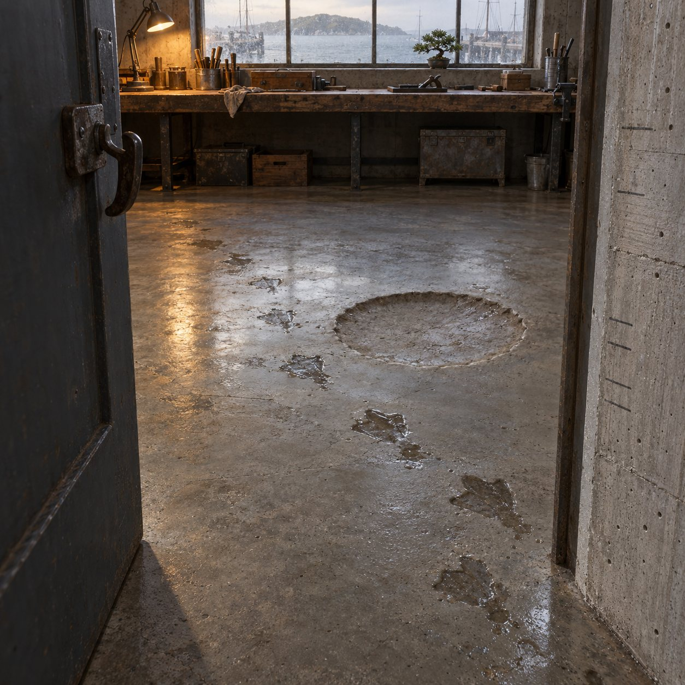

# The Workshop

Raw concrete with the timber grain left in, a door hooked open, a salt-hazed window over the harbour, and a lamp lit late.

The Workshop sits low at the end of the lane, the last door before the path turns to the water. It's poured concrete, and nobody sanded the board-marks off, so you can still read the wood in the walls. The door is hooked open, always. Inside: one big steel window, never quite clean, a long scarred workbench under it, and a couch facing the weather. A lamp stays on after everyone sensible has gone to bed.

Look down and there's the shape of a dropped pie pressed into the floor, left there on purpose. Look up and there's a thumb-sized hole in the ceiling where a knot fell out, and an old eel asleep in the rafters beside a sign that says DON'T FEED THE EELS. Pencil lines on the doorframe mark the days the water came up. Wet webbed footprints come and go across the floor.

A bonsai keeps its own slow time on the windowsill. Outside, a bucket on a pivot fills from the rain and tips, fills and tips, all day. And some afternoons a black and white cat called Orbit wanders in through the open door. He belongs to someone else. He just visits, takes the couch arm, and pretends not to notice the bird.
